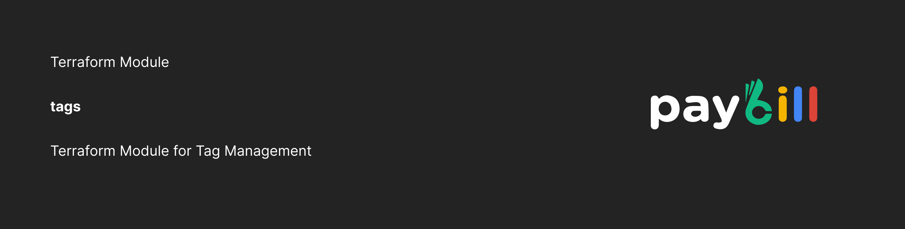

  <a href="https://paybill.dev" target="_blank">
    <picture>
      
    </picture>
  </a>

# Terraform Module: Tag Manager  

## Overview

This module is responsible for managing the tags we use at Paybill when creating resources in Cloud.

<!-- BEGIN_TF_DOCS -->
## Requirements

| Name | Version |
|------|---------|
|  [terraform](#requirement\_terraform) | >= 1.3.0 |

## Providers

No providers.

## Modules

No modules.

## Resources

No resources.

## Inputs

| Name | Description | Type | Default | Required |
|------|-------------|------|---------|:--------:|
|  [environment](#input\_environment) | The environment the resource will be created in. | `string` | n/a | yes |
|  [extra\_tags](#input\_extra\_tags) | Additional tags to add to your resources. | `map(string)` | `{}` | no |
|  [project](#input\_project) | The name of the project being worked on. | `string` | n/a | yes |

## Outputs

| Name | Description |
|------|-------------|
|  [extra\_tags](#output\_extra\_tags) | n/a |
|  [tags](#output\_tags) | n/a |
<!-- END_TF_DOCS -->